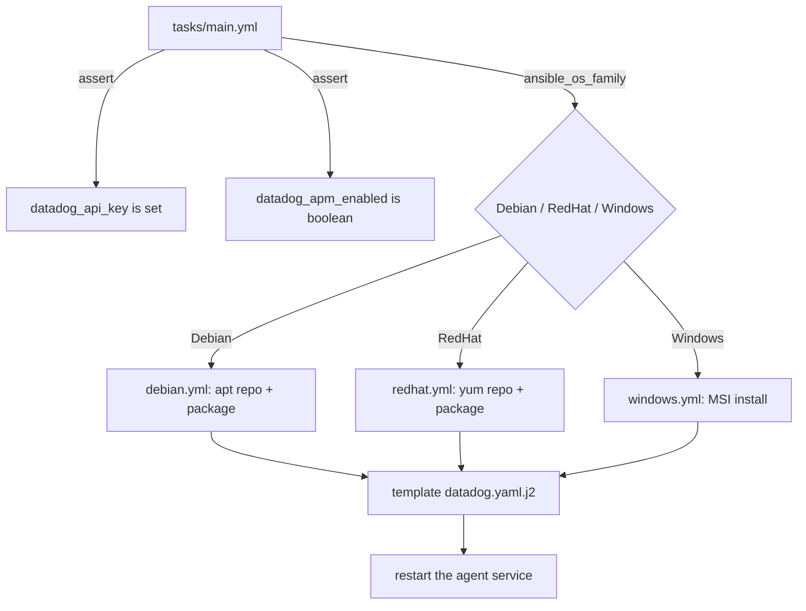

# ansible-datadog-agent-rollout

An Ansible role that installs and configures the Datadog agent across mixed Linux/Windows
fleets, with tagging and optional APM instrumentation.

**Scope.** Datadog only - New Relic is explicitly out of scope. No dashboards, no monitors, no
extra Datadog integrations beyond the agent itself. Never run against a real host (Linux or
Windows) or a real Datadog account - see Status below.

## Architecture



## Role structure

- `roles/datadog_agent/tasks/main.yml` - asserts the API key and `apm_enabled` type, then
  dispatches to one of three short, OS-specific files via `include_tasks` keyed on
  `ansible_os_family`.
- `roles/datadog_agent/tasks/debian.yml` / `redhat.yml` - add the Datadog package repo, install
  `datadog-agent`, template the config, ensure the service is running.
- `roles/datadog_agent/tasks/windows.yml` - download and install the Datadog MSI
  (`ansible.windows.win_package`), template the same config shape, ensure the Windows service
  is running.
- `roles/datadog_agent/templates/datadog.yaml.j2` - one template for every OS: `api_key`,
  `site`, `tags` (a dict rendered to the agent's `key:value` tag list), and `apm_config.enabled`.
- `roles/datadog_agent/defaults/main.yml` - `datadog_site`, `datadog_tags: {}`,
  `datadog_apm_enabled: false`, and `datadog_config_path` (OS-appropriate default, overridable -
  see Tests). No default for `datadog_api_key` - see Security considerations.

## Prerequisites

- Ansible core `2.22.0` (pinned in `requirements.txt`).
- The `ansible.windows` collection, version `3.9.2` (pinned in `requirements.yml`):
  `ansible-galaxy collection install -r requirements.yml`.
- A Datadog API key, supplied by the caller - never committed here.

## Usage

```bash
pip install -r requirements.txt
ansible-galaxy collection install -r requirements.yml

export DATADOG_API_KEY=change-me
ansible-playbook -i inventory/hosts.example.ini site.yml \
  -e "datadog_api_key={{ lookup('env', 'DATADOG_API_KEY') }}" \
  -e "@group_vars/all.example.yml"
```

See `inventory/hosts.example.ini` for the sample inventory shape (`example.com` names, no real
IPs) and `group_vars/all.example.yml` for sample `tags`/`apm_enabled` values.

## APM

When `datadog_apm_enabled: true`, the rendered config sets `apm_config.enabled: true`, which is
what turns on the Datadog trace agent. **What this proves:** the agent is configured to accept
traces. **What this does not prove:** that the application is actually instrumented to send
traces, that traces reach Datadog, or that APM data appears correctly in the Datadog UI - none
of that has been exercised, because this repo never ran against a real agent or account.

## Security considerations

- `datadog_api_key` has no default and is never read from this repo - it must come from the
  caller, typically `lookup('env', 'DATADOG_API_KEY')` or an Ansible Vault-encrypted variable.
  `tasks/main.yml`'s first task asserts it's set and non-empty before anything else runs; a
  missing key fails the play with a specific message rather than templating an empty one.
- No real account IDs, hostnames, or API keys appear anywhere in this repo -
  `inventory/hosts.example.ini` uses `example.com` names only.
- The rendered config file is owned by `dd-agent`/mode `0640` on Linux, matching the agent's
  own expected permissions - not world-readable.

## Idempotency

The only two things that can report `changed` on a re-run with the same variables are the
templated config file and the service state. A second check-mode run against the same inputs
should show no changes - this is checked for the config-rendering task specifically (see
Tests); it has never been checked end to end against a real host's actual package/service
state, since there is no real host to check it against.

## Tests

```bash
pip install -r requirements.txt
ansible-galaxy collection install -r requirements.yml
yamllint .
ansible-lint
bash tests/run.sh
```

`tests/run.sh` covers, with no real hosts and no Datadog account:

- `ansible-playbook site.yml --syntax-check`, once with `ansible_os_family` faked to each of
  Debian, RedHat, and Windows.
- A check-mode, `--tags datadog_config` run of `tests/check-mode-config.yml` against
  `localhost`, once faking the Debian path and once faking the Windows path, with
  `datadog_config_path` overridden to a throwaway file (no real system path touched, no root
  needed). Asserts the check-mode diff output contains the configured tags and
  `apm_config.enabled: true`.
- `tests/negative-missing-api-key.yml` - confirms the play fails with the exact expected
  message when `datadog_api_key` is unset.
- `tests/negative-bad-apm-type.yml` - confirms a non-boolean `datadog_apm_enabled` is rejected
  with the exact expected message.

**This machine cannot run any of the above locally.** `ansible-core` does not run on this
Windows machine at all - confirmed in earlier challenges, it fails importing `grp`, a Unix-only
stdlib module, before it can do anything else. Every command above was read and reasoned
through, and every YAML file and the Jinja2 template were validated locally with Python's own
`yaml` and `jinja2` libraries (no `ansible-core` needed for that), but `ansible-lint`,
`ansible-playbook`, and the actual test run are CI-only - their result in this PR is whatever
CI reports, not a locally-reproduced claim.

No binaries are downloaded in CI for this challenge - `ansible-core`, `ansible-lint`,
`yamllint`, and the `ansible.windows` collection all come through `pip`/`ansible-galaxy`'s own
package integrity, not a raw `curl` this repo would need to checksum itself.

## Status

Never run against a real Linux host, a real Windows host, or a real Datadog account.
Validated only with `yamllint`, `ansible-lint`, `--syntax-check`, and the check-mode/negative
tests described above, all via CI - this machine cannot run `ansible-core` to reproduce any of
it locally.

## Known limits

- One role, one config template, three OS paths - matching the problem statement exactly. No
  dashboards, no monitors, no extra Datadog integrations.
- The Windows path's actual MSI install and service management
  (`ansible.windows.win_package`/`win_service`) have never been exercised at all - they can't
  be, without a real Windows target; only their YAML syntax has been checked.
- `datadog_config_path`'s override exists specifically to make the config-rendering task
  testable without root or a real system path - production use should leave it at the default.
